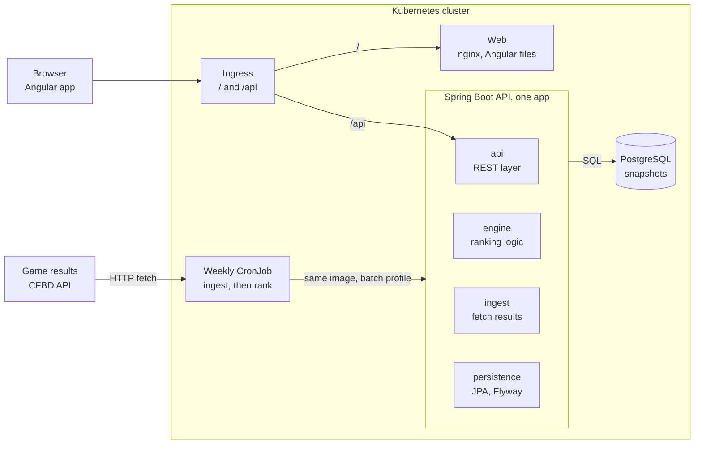
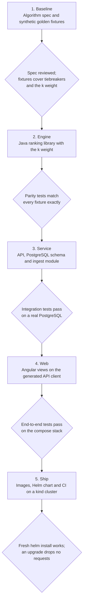

# PRD: eye-test on Spring Boot, Angular and Kubernetes

Nov 11, 2026 · @Dan · Updated Nov 13, 2026

Terms in this PRD are defined in [CONTEXT.md](./CONTEXT.md). Decisions that are hard to reverse, or that a reader could not guess from the code, are recorded in [docs/adr](./docs/adr).

## Overview

eye-test ranks FBS college football teams using only on-field results, with no human voting. Each team gets a win score, ties are broken by a fixed procedure, and the ranking is compared to a published poll. The purpose is to set a mechanical, codified method beside the College Football Playoff committee's rankings. This PRD ports it from a Python command-line tool to a Spring Boot service with an Angular front end, packaged as containers and deployable to Kubernetes.

Today the tool is a personal Python project. Ties are broken with the NFL's tiebreaker model, and the output is compared by hand against the College Football Playoff (CFP) committee rankings, falling back to the AP Top 25. It also has a quality weight `k`, set from the command line (0 to 2, default 1), where losses earn no credit whatever the opponent. Only games against FBS opponents count, and a team that loses to a non-FBS opponent is disqualified from the final ranking.

The port keeps the ranking logic identical, then adds what a CLI cannot: a browsable web UI, stored weekly ranking history, and a repeatable deployment. It doubles as a public portfolio project in idiomatic Java, Spring Boot, Angular and Kubernetes.

## Goals and non-goals

The port succeeds when the Java service reproduces the Python rankings exactly and runs from a single deployment command.

**Goals**

1. Behavioral parity: for every synthetic league in a golden test set, the Java engine returns the order and exact scores that the written algorithm spec, taken from the Python tool's logic, calls for.
2. A web UI for viewing rankings, a team's resume, and a side-by-side comparison with the compared poll (normally the CFP committee ranking).
3. Weekly ranking snapshots stored in a database, so history is read, not recomputed.
4. Containerized services deployable to any conformant Kubernetes cluster with one Helm command.
5. Clean, idiomatic Java, Spring Boot and Angular that a reviewer can read as a portfolio piece.

**Non-goals**

- Changing the ranking methodology beyond parity, which already includes the quality weight `k`.
- Predicting future games or ranking other sports.
- User accounts, comments or any write access for the public in v1. The public site is read-only and cannot trigger a computation.
- Redistributing CollegeFootballData (CFBD) data: no real game data in the repository and no bulk game or poll feeds.
- Postseason games. A week is a regular-season week.
- A microservice split, service mesh or multi-cluster setup. One modular Spring Boot app is enough.
- A mobile app or a commercial service with an uptime guarantee.

## Users and use cases

The main user is the author, who checks the ranking each week against the CFP committee. A secondary audience is read-only visitors, including engineers reviewing the repo.

| User | Use case | Frequency |
| --- | --- | --- |
| Maintainer | Have new results ingested and the week's ranking computed automatically, or run the batch profile by hand for a backfill or another `k` | Weekly in season |
| Maintainer | Compare the ranking to the compared poll (normally the CFP committee list) and inspect large gaps | Weekly in season |
| Visitor | Browse the current ranking and any past week, choosing among the `k` values stored for it | Occasional |
| Visitor | Open a team's resume to see why it ranks where it does | Occasional |
| Reviewer | Clone the repo and start everything locally with one command, with no CFBD key | Once |

## Functional requirements

P0 items are needed for parity and a usable first release. P1 adds the web-only capabilities. P2 is nice to have.

| ID | Requirement | Priority |
| --- | --- | --- |
| FR-1 | Ingest a season's teams, conferences, regular-season games and polls from CFBD and store them, fetching only new or incomplete weeks | P0 |
| FR-2 | Compute a ranking from every completed regular-season game so far using the same win score logic as the Python tool: only games against FBS opponents count, and a team with a loss to a non-FBS opponent is disqualified from the final ranking though its games still count for others | P0 |
| FR-3 | Break ties with the NFL-style procedure, applying the twelve rules in the order the Python tool does, including the poll as rule 11 and alphabetical by abbreviation as rule 12 | P0 |
| FR-4 | Persist each computed ranking as an immutable snapshot keyed by season, week and `k`, and record the compared poll's name and week. Every compute adds a new snapshot, and the latest one is the one shown. Each snapshot also stores its resume contributions and its playoff field | P0 |
| FR-5 | Show any stored ranking as a table with team, rank, record and score, with disqualified teams listed separately along with the non-FBS loss | P0 |
| FR-6 | Show a team resume: schedule, results, opponents and how each result contributed to the win score | P0 |
| FR-7 | Support the quality weight `k`, from 0 to 2 and defaulting to 1; `k` is always set, `k = 0` is the baseline, and losses earn no credit at any `k` | P0 |
| FR-8 | Compare a snapshot to the compared poll (the requested poll for the poll week, normally the committee's, falling back to the AP Top 25 for that week), with a rank-difference column | P1 |
| FR-9 | Removed. The public site is read-only; there is no on-demand compute from the UI or API | n/a |
| FR-10 | Run ingest and ranking automatically each week through a CronJob: ingest, then compute a snapshot for each `k` in a chart-value list (default 0 and 1), only when a game or poll for that week changed. A newly published final committee poll triggers one last snapshot | P1 |
| FR-11 | Provide a command-line entry point (a Spring Boot batch profile) for the weekly job, for backfilling a whole season (one snapshot per week per `k`), and for seeding the sample season, with an optional requested poll and poll week | P1 |
| FR-12 | Export a snapshot as CSV or JSON (snapshots only, never raw games or polls) | P2 |
| FR-13 | Show the playoff field for a snapshot: 12 teams through the 2026 season and 24 from 2027, seeded by rank, with byes and the opening rounds | P1 |
| FR-14 | Show the Python report extras for a snapshot: top 10 snubs, top 10 overrated, "Nailed It!" teams and the bottom 10 | P2 |
| FR-15 | Use the batch profile for local runs and parity checks | P2 |
| FR-16 | Show "Data provided by CollegeFootballData.com" in the site footer | P1 |

## Ranking engine

The engine is the product's core, so it ships first and is proven against the spec's hand-derived expected results before anything else is built on it.

- **Pure library.** A Maven module with no Spring or database dependency. It takes teams (with abbreviation, FBS flag and conference for the season), games (with a completed flag and both touchdown counts), the compared poll's ranks, the season year and a config (including `k`), and returns an ordered ranking with per-team scoring detail.
- **Spec before code.** Extract the algorithm from the Python source into a short written spec: how the win score is computed, how FBS-only counting and disqualification work, and the exact tiebreaker order. The Python logic is treated as correct: its behavior, quirks included, is ported as-is unless the owner decides otherwise. The manual "wife choice" tiebreaker is commented out in Python and is not ported.
- **Exact arithmetic.** Win percentage, win score and `k` are exact rational numbers, never floating-point, so ties are detected exactly as in Python. See [ADR 0001](./docs/adr/0001-exact-rational-scoring.md).
- **Golden-file parity tests.** Fixtures are JSON and entirely synthetic: hand-built leagues whose expected order and exact scores are worked out by hand from the spec. The Python tool is not run to produce or check them. They cover every tiebreaker rule, FCS-loss disqualification, an independent team and the poll fallback, each with and without `k`. No real game data is committed to the repository (see [ADR 0002](./docs/adr/0002-synthetic-data-only.md)). The Java engine must return the expected order and exactly equal scores.
- **Deterministic ties.** The same input always yields the same order. Tiebreaking is a procedure, not a sort: each of the eleven rules before the alphabetical fallback is a pure function over a tied group that returns one top team or falls through, and the procedure places one team and restarts the rest from rule 1. Unit-test each rule on its own and test the whole procedure against the golden files.
- **Quality weight.** `k` runs from 0 to 2, defaults to 1 and is always set. `k = 0` is the baseline. Each win over an FBS opponent is worth `1 + k × (opponent win percentage − 0.5)` and each loss is worth 0. Parity tests cover runs with and without a quality weight.
- **Playoff field.** The format comes from the season year inside the engine (12 teams through 2026, 24 from 2027), not from the config. A future format change needs an ADR.
- **Python logic is correct.** The Python logic is the source of truth and is ported as-is. A suspected bug is raised with the owner; behavior changes only if the owner decides so.

## Ingest and snapshots

- **Regular season only.** Ingest requests regular-season games. A week is a regular-season week, and postseason games are never ranked.
- **Games and week label.** A snapshot counts every completed game so far. Upcoming games are stored but never scored. The snapshot's week is the highest week with a completed game.
- **Compared poll.** The requested poll's rankings for the poll week, which defaults to the snapshot's week and can be overridden on a batch run; the AP Top 25's rankings for that week if the requested poll has none; none when neither has any. This is Python's selection, except that rankings are requested under both season types so the committee's final poll is found wherever CFBD files it. The snapshot records the poll's name and week, or none.
- **Incremental fetch.** Port Python's policy, not its storage: never refetch completed games, refetch weeks that still have an incomplete game, always refetch polls, and do a full fetch only when forced or the season changes. The normalized games in PostgreSQL are the cache, with no separate raw-response cache. Python makes about two CFBD calls per fetched week (games, and per-game team stats for touchdowns) plus about five fixed calls, so a full-season backfill is roughly 35 calls against a free-tier budget of 1,000 a month.
- **Season and weeks.** The default season is the previous calendar year before August 1 and the current year after, as in Python. Ingest fetches weeks up to the latest started regular-season week from CFBD's calendar.
- **Snapshot creation.** The weekly job writes a snapshot only when a game or poll for the week changed. In the offseason it logs "no change" and writes nothing. Snapshots are never updated.
- **Stored with the snapshot.** A snapshot keeps a resume row per team-game (result and contribution to the win score) and the playoff field as seeded entries, so history is read, not recomputed.
- **Disqualified teams.** A disqualified team has an entry with a null rank. FCS teams never appear as ranked teams.

## Architecture

The target is a modular monolith: one Spring Boot application with enforced module boundaries, one PostgreSQL database, and a separate static front end. A single domain with one maintainer does not justify microservices.

The Spring Boot code splits into four Maven modules: `engine` (pure ranking logic), `ingest` (call the CFBD API through a client generated from its OpenAPI spec, behind a thin adapter, and normalize game results), `persistence` (JPA entities, repositories, Flyway migrations) and `api` (REST controllers and the application entry point). Dependencies point inward, so `engine` knows nothing about the rest.

Traffic enters through one ingress: the web container serves the Angular files and the API container handles `/api`, which is read-only. A weekly CronJob reuses the API image to ingest results and write new snapshots; it and the batch profile are the only writers.

| Concern | Choice | Why |
| --- | --- | --- |
| Runtime | Java 25 LTS | Current long-term-support release; pin the version at kickoff |
| Backend framework | Spring Boot 4.x: Web MVC, Data JPA, Validation, Actuator | Mainstream stack for Java backend roles |
| Build | Maven, multi-module | Most common in enterprise Java shops |
| Database | PostgreSQL with Flyway migrations | Versioned schema, runs identically in compose and Kubernetes |
| API contract | OpenAPI via springdoc, used to generate the Angular client | One source of truth for both sides |
| Front end | Angular (current major at kickoff), standalone components, signals, strict TypeScript | Modern Angular defaults |
| Secrets | Sealed Secrets (Bitnami) | Encrypted secrets that are safe to commit; only the in-cluster controller decrypts them |
| Tests | JUnit 5, AssertJ, Testcontainers; Angular CLI test runner; Playwright for end-to-end | Real database in integration tests |
| Packaging | Container images per service, published to GitHub Container Registry | Repo already lives on GitHub |
| Orchestration | Kubernetes, packaged as a Helm chart, developed on kind | Widely recognized, runs on a laptop |

## API and data model

The REST API is versioned under `/api/v1`, read-only, and described by an OpenAPI document that the Angular client is generated from. It returns derived data only: snapshots, entries, the playoff field and one team's resume for one season. No endpoint lists games or polls in bulk.

| Method | Path | Purpose |
| --- | --- | --- |
| GET | `/api/v1/seasons` | List seasons with stored data |
| GET | `/api/v1/seasons/{year}/rankings?week=&k=` | Latest matching snapshot for a season, week and `k`, and the `k` values stored for that week |
| GET | `/api/v1/rankings/{id}` | One snapshot with all entries |
| GET | `/api/v1/teams/{id}/resume?season=` | A team's schedule, results and score contributions |
| GET | `/api/v1/seasons/{year}/comparison/poll?week=` | Snapshot beside the compared poll (the requested poll for the poll week, or the AP Top 25 for that week as the fallback) |
| GET | `/api/v1/rankings/{id}/playoff` | The playoff field for a snapshot |

Scores are returned as an exact fraction (numerator and denominator) plus a decimal rounded for display, with the same precision as the Python report. Sorting and comparison always use the exact fraction.

The batch profile and weekly CronJob are the only writers, and the API has no write path.

The database holds these tables. Columns are the minimum the Python tool already consumes and should be confirmed against its source. Scores are stored as exact fractions (numerator and denominator), not floating-point.

| Table | Key columns |
| --- | --- |
| `conference` | id, name, is FBS |
| `team` | id, name, abbreviation |
| `team_season` | season, team id, conference id, is FBS |
| `season` | year |
| `game` | id, season, week, home team, away team, home score, away score, home touchdowns, away touchdowns, completed |
| `ranking_snapshot` | id, season, week, `k`, compared poll name, compared poll week, created at |
| `ranking_entry` | snapshot id, team id, rank (null when disqualified), score, record, tiebreak note (the rule that placed the team, or none), playoff seed (null when not in the field) |
| `ranking_entry_game` | entry id, game id, result, opponent, contribution to the win score |
| `poll_ranking` | poll name, season, poll week, rank, team id |

The compared poll is recorded on the snapshot as a name and week, or as none when no poll was available or polls were turned off. A disqualified team's non-FBS loss appears in its `ranking_entry_game` rows.

## Angular front end

The front end is a single-page app with three views, served as static files and talking only to `/api/v1` on the same origin, so no CORS configuration is needed.

| View | What it shows |
| --- | --- |
| Rankings | Table for a chosen season and week, with a `k` selector listing only the values stored for that week and a link to each team; the playoff field appears beside it, and disqualified teams are listed separately with their non-FBS loss |
| Team resume | Schedule and results, opponent quality, and each result's contribution to the win score |
| Poll comparison | Our rank beside the compared poll's, with the difference highlighted and sortable; labeled "CFP comparison" when the compared poll is the committee's |

Requirements:

- Standalone components, signals for state and strict TypeScript, with no `any` in committed code.
- API client generated from the OpenAPI document in the build, never hand-written.
- Runtime settings (API base path, build version) read from a `config.json` served beside the app, so one image works in every environment.
- Scores shown as decimals matching the Python report's precision.
- A footer crediting CollegeFootballData.com.
- Responsive down to phone width, keyboard navigable, and meeting WCAG 2.1 AA contrast and labeling.
- Loading, empty and error states on every view.

## Containerization

Two images are produced from the repo: `eye-test-api` and `eye-test-web`. Anyone can run the full stack locally with one `docker compose up`.

- **API image.** Built from the layered Spring Boot jar on a JRE-only base image, running as a non-root user. JVM memory is container-aware (percentage-based heap), so it respects Kubernetes limits.
- **Web image.** Multi-stage build: compile the Angular app, then copy the static output into an unprivileged nginx image with a single-page-app fallback to `index.html`.
- **Configuration.** All settings come from environment variables or mounted files, following twelve-factor practice. No secrets or environment-specific values are baked into an image.
- **Tags.** Every image is tagged with the git commit SHA and, on release, a semantic version. `latest` is never deployed.
- **Registry.** Images publish to GitHub Container Registry from CI.
- **Local stack.** The compose file starts the API, web and PostgreSQL and seeds an invented sample season through the batch profile. The sample has fictional teams in two conferences plus an independent, several weeks, an FCS upset that disqualifies a team, and at least one tie that needs a deep tiebreaker. It reuses the synthetic fixtures where possible and needs no CFBD key; the README says it runs on invented data.
- **Hygiene.** Images are scanned in CI and the build fails on critical vulnerabilities. Multi-architecture builds (amd64 and arm64) are a P2 item.

## Kubernetes deployment

The deliverable is a Helm chart, `charts/eye-test`, that installs the whole system on a fresh cluster. Development and CI use a local kind cluster; production runs on DigitalOcean Kubernetes (DOKS) in the sfo3 region, on a small cluster of the smallest available nodes, chosen for its free control plane and low setup friction.

| Resource | Kind | Requirements |
| --- | --- | --- |
| Web | Deployment, Service | 2 replicas, nginx, read-only root filesystem |
| API | Deployment, Service | 2 replicas, resource requests and limits, readiness and liveness probes on the Actuator health endpoints, a PodDisruptionBudget |
| Database | StatefulSet (dev) or external (prod) | In-cluster PostgreSQL for dev and CI only; production uses DigitalOcean Managed PostgreSQL; a local PostgreSQL also works by setting the connection string |
| Migrations | Part of API startup | Flyway runs when the API starts and relies on its built-in lock, so concurrent replicas are safe. The weekly job runs with migration off and waits for the API's schema. There is no Helm hook, so a fresh install has no ordering problem with the in-cluster database |
| Weekly job | CronJob | Same API image on a batch profile; ingests, then computes a snapshot for each `k` in a chart-value list (default 0 and 1); the schedule is a chart value, default Wednesday 12:00 UTC, after the committee's Tuesday evening release |
| Routing | Ingress | One host: `/` to web, `/api` to api; TLS through cert-manager |
| Configuration | ConfigMap, Sealed Secret | Database credentials and the CFBD API key are supplied as SealedSecrets that the chart expects by name; only the weekly job and batch profile read the CFBD key; nothing sensitive in values files committed to git |
| Isolation | NetworkPolicy | Default deny. Allow ingress to web and api. API pods may reach only the database and DNS. The job pod may reach the database, DNS and CFBD on port 443. Nothing else has outbound access |
| Scaling | HorizontalPodAutoscaler | Present but off by default; load is small |

Acceptance criteria:

1. `helm install` on an empty kind cluster brings every pod to ready with no manual steps.
2. `helm upgrade` to a new image tag rolls out with no failed requests during the rollout.
3. `helm lint` and a manifest validator pass in CI.
4. Removing a pod or the CronJob run never loses stored data.

## CI/CD, testing and operations

A GitHub Actions pipeline builds, tests, scans and publishes on every push, and deploys to a throwaway kind cluster as a smoke test.

| Area | Requirement |
| --- | --- |
| Pipeline | Backend build and tests, Angular lint, tests and build, image build and scan, Helm lint, install into kind and run a smoke test |
| Parity tests | Golden-file comparison on the synthetic fixtures runs on every change to the engine module |
| Unit and integration | JUnit 5 for the engine and services; Testcontainers with a real PostgreSQL for the persistence and API layers |
| End to end | Playwright runs the main flows against the compose stack |
| Contract | The OpenAPI document is generated in CI; a diff against the committed copy fails the build if the API changed unannounced |
| Observability | Actuator health, Micrometer metrics in Prometheus format, structured JSON logs with a request id |
| Security | Dependency update bot, image and dependency scanning, non-root containers, input validation on every endpoint, a read-only public API with no write path |
| Releases | A git tag publishes versioned images and a packaged chart |

## Delivery plan

Diamonds are gates: a phase starts only after the previous gate passes. The gates are strict, with no parallel phases, because one maintainer builds this in spare time.

## Success metrics

The port is done when parity holds and the deployment is repeatable. The numbers below are proposed targets to adjust once real measurements exist.

| Metric | Target |
| --- | --- |
| Ranking parity | 100% of synthetic golden fixtures match in exact order, with exactly equal scores |
| Fresh install | `helm install` on an empty kind cluster reaches all pods ready in under 5 minutes |
| Read latency | Ranking and resume endpoints answer in under 200 ms at the 95th percentile |
| Compute time | A full-season ranking computes in under 2 seconds |
| Test coverage | Engine at least 90% line coverage, whole project at least 80% |
| CI duration | Full pipeline under 10 minutes |
| Image size | API image under 300 MB, web image under 60 MB |
| Security | No critical vulnerabilities in released images |

## Risks, assumptions and open questions

The biggest risk is that the Python tool's behavior is not fully written down, so the written spec, from which every expected result is derived, is the hardest part of the port.

| Risk | Mitigation |
| --- | --- |
| Python logic has undocumented or accidental behavior | Write the algorithm spec first; build synthetic golden fixtures from it by hand; port quirks as-is and raise any suspected bug with the owner |
| Ordering and number-representation differences between Python and Java | Use exact rational arithmetic and explicit tie rules; compare scores for exact equality (ADR 0001) |
| Synthetic fixtures may miss behavior that real seasons exercise | Hand-build leagues for each tiebreaker rule and each FCS or independent edge, and review the fixture list at the Baseline gate |
| The CFBD API is rate-limited (free tier: 1,000 calls a month), changes its schema or restricts reuse | Fetch only new or incomplete weeks (about two calls per week); keep the ingest module behind an interface; with no official Java client, generate one from the OpenAPI spec and test the adapter against hand-written responses shaped like the API's |
| CFBD terms bar redistributing raw data as a dataset | No real game data in the repo, derived outputs only, no bulk game or poll endpoints, the key kept server-side, and a credit in the footer (ADR 0002). Read the full current terms before deploying publicly |
| Scope creep into new ranking ideas | Hold the non-goals; park ideas as issues |
| The stack is heavy for a small app | Keep to one modular monolith and skip extras such as a service mesh |
| Cloud cluster costs creep up on a personal project | Develop and test on kind; deploy to a small managed cluster with a budget alert, and scale it down when idle |

**Assumptions**

- A single maintainer builds this in spare time, so phases have gates, not calendar dates.
- The deployed site is public and read-only for visitors, with no sign-in in v1. Only the weekly job and the batch profile write snapshots.
- The weekly job runs after the committee's Tuesday release, so the latest published poll matches the latest completed games.
- The Python repo is the source of truth for current behavior, and its `GLOSSARY.md` seeded [CONTEXT.md](./CONTEXT.md).
- All code in this repository is written by the maintainer, not by AI.
